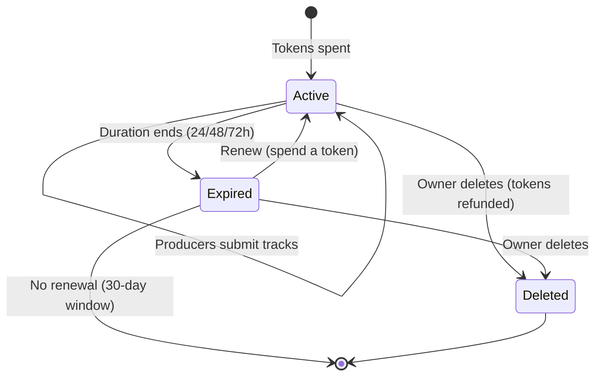

import SyntheticFixtures from "/snippets/developer/synthetic-fixtures.mdx";

The Beat Requests API powers the custom beat request marketplace. Users spend tokens to create time-limited requests specifying their needs (genre, BPM, mood, budget). Producers browse active requests and submit tracks to fulfill them.

<Info>
  **Base URL:** `https://open.beatpass.ca/api/v1/beat-requests`

  **Authentication:** All beat request endpoints require a valid Bearer token.
</Info>

---

## Request Lifecycle

<Steps>
  <Step title="Create Request">
    User spends tokens to create a beat request with specifications (genre, BPM, mood, budget, reference track). Requests are active for 24, 48, or 72 hours.
  </Step>
  <Step title="Producers Browse">
    Producers view active requests and submit tracks that match the specifications.
  </Step>
  <Step title="Review Submissions">
    The requester reviews submitted tracks and connects with producers directly if interested.
  </Step>
  <Step title="Expire or Renew">
    Requests expire automatically after the chosen duration (24/48/72h). Expired requests can be renewed within 30 days by spending tokens again.
  </Step>
</Steps>



---

## Token System

Beat requests use a token-based system tied to the user's subscription plan:

<Columns cols={3}>
  <Card title="Token Cost" icon="coins">
    24h = 1 token, 48h = 2 tokens, 72h = 3 tokens
  </Card>
  <Card title="Monthly Allocation" icon="calendar">
    Tokens refresh monthly based on subscription plan
  </Card>
  <Card title="Refunds" icon="rotate-left">
    Tokens are refunded when the owner deletes a request (capped at plan allowance)
  </Card>
</Columns>

---

## Endpoints

### List Visible Requests

Browse active requests with pagination. Read `status`, `expires_at`, and `can_renew` from each record. Use **My Requests** to find your own expired requests and renewal options.

```http
GET /api/v1/beat-requests
```

| Query | Behavior |
| --- | --- |
| `page`, `per_page` | Page number and page size; default 20 items, maximum 50 |
| `q` | Search request text and displayed request metadata |
| `genre` | Filter by genre |
| `responses` | `none` for no submissions, or `budget` for requests with a budget |
| `sort` | `ending` for earliest expiry; otherwise newest first |

**Response:**

<SyntheticFixtures />

```json
{
  "success": true,
  "data": [
    {
      "id": "00000000-0000-4000-8000-000000000042",
      "user_id": 900000001,
      "user_name": "Synthetic text fixture",
      "content": "Synthetic text fixture",
      "genre": "Trap",
      "bpm_range": "135-145",
      "mood": "Dark",
      "budget": "$50-100",
      "expires_at": "2025-01-16T14:30:00Z",
      "time_remaining": "23 hours from now",
      "hours_remaining": 23
    }
  ],
  "count": 1,
  "pagination": {"total": 1, "current_page": 1, "last_page": 1}
}
```

---

### Create Request

Create a new beat request by spending tokens. Supply a new `request_id` UUID for each intended request and keep it with the unchanged payload until you know the result. This lets a retry reconcile an interrupted response instead of spending tokens on a second post.

```http
POST /api/v1/beat-requests
```

<ParamField body="request_id" type="string">
  Optional client-generated UUID identifying this posting attempt. Reuse it only with the identical request fields and duration. A matching retry returns `200` with `replayed: true` and no additional token debit. Reusing the UUID for changed details returns `409`; review the intended request before starting another attempt.
</ParamField>
<ParamField body="content" type="string" required>
  Description of the beat you're looking for. Must be 10–500 characters.
</ParamField>
<ParamField body="reference_track" type="string" required>
  Valid reference-track URL, up to 500 characters. Free-text descriptions are not accepted in this field.
</ParamField>
<ParamField body="genre" type="string">
  Preferred genre.
</ParamField>
<ParamField body="bpm_range" type="string">
  Preferred BPM range (e.g., "135-145").
</ParamField>
<ParamField body="key" type="string">
  Preferred musical key.
</ParamField>
<ParamField body="mood" type="string">
  Desired mood or vibe.
</ParamField>
<ParamField body="budget" type="string">
  Budget range.
</ParamField>
<ParamField body="duration_hours" type="integer">
  How long the request stays active: `24`, `48`, or `72`. Default: `24`.
</ParamField>

**New request response (201, excerpt):**

<SyntheticFixtures />

```json
{
  "success": true,
  "message": "Beat request posted successfully",
  "replayed": false,
  "data": {
    "id": "00000000-0000-4000-8000-000000000042",
    "content": "Synthetic content Fixture",
    "expires_at": "2025-01-16T14:30:00Z",
    "time_remaining": "24 hours from now",
    "hours_remaining": 24
  },
  "token_info": {
    "tokens_remaining": 2,
    "tokens_spent": 1,
    "monthly_limit": 5,
    "used_this_month": 3,
    "plan_type": "pro",
    "plan_name": "Pro Plan",
    "reset_date": "2025-02-01",
    "days_until_reset": 16
  }
}
```

**Token or posting allowance exhausted (429):**

Read `message` and the current `token_info`. Posting failures return `tokens_spent: 0`; a matching replay also spends no additional tokens. A feature allowance does not reset simply because the HTTP retry interval has passed. Check token status before offering another post.

**Uncertain result:** Keep the posting UUID and payload. Refresh **My Requests** and reconcile with the same UUID before creating a different attempt. A delayed notification is not evidence that posting failed.

---

### Get Request

Get details for a specific beat request.

```http
GET /api/v1/beat-requests/{id}
```

---

### Delete Request

Delete a beat request. The request owner can delete. Any eligible request-token refund goes to that owner.

```http
DELETE /api/v1/beat-requests/{id}
```

<Note>
  When a request is deleted, the spent tokens are refunded to the owner (capped at plan allowance). For example, deleting a 72-hour request refunds up to 3 tokens, but never exceeds the user's monthly token limit.
</Note>

---

### Submit Track

Submit a track to an active beat request. Producers use this endpoint to send their beats to a requester. Each producer can submit up to 5 tracks per request.

```http
POST /api/v1/beat-requests/{id}/fulfill
```

<ParamField body="track_id" type="integer" required>
  The ID of an existing track to submit. Must be a platform-hosted track owned by (or collaborated on by) the authenticated user. A completed audio fingerprint is not required.
</ParamField>

**Validation Requirements:**
- Track must be uploaded to the platform (external links not accepted)
- The track may still be undergoing fingerprint processing; duplicate-audio checks can reject matching audio
- Producer must have upload permission and own or collaborate on the track
- Cannot submit to your own request
- Cannot submit the same track twice to the same request

---

### Get Submissions

Get tracks submitted to your request. The response has `data` and `pagination.total`, `current_page`, and `last_page`. Pages contain up to 20 submissions.

```http
GET /api/v1/beat-requests/{id}/submissions
```

---

### Renew Request

Renew an expired request within 30 days of expiration. Renewal consumes one token and uses the request's existing duration. Read the returned `expires_at` for the actual end time rather than parsing the success message or assuming the original token cost is charged again.

```http
POST /api/v1/beat-requests/{id}/renew
```

---

### Log Request View

Record that a producer has viewed a beat request. Used for analytics and engagement tracking.

```http
POST /api/v1/beat-requests/{id}/track-view
```

<ParamField path="id" type="string" required>
  Beat request ID.
</ParamField>

---

## User-Specific Endpoints

### My Requests

Get the authenticated user's own beat requests, with the same paginated envelope as discovery. Use `status=active` or `status=expired` to filter; omit the filter to include both. `q`, `genre`, `sort`, `responses`, and `per_page` are also supported.

```http
GET /api/v1/beat-requests/user/my-requests
```

### My Submitted Tracks

Get tracks the authenticated user has submitted to beat requests.

```http
GET /api/v1/beat-requests/user/my-tracks
```

### Token Status

Check the user's current token balance and rate limit status.

```http
GET /api/v1/beat-requests/user/rate-limit-status
```

---

## Reference Data

### Statistics

Get platform-wide beat request statistics.

```http
GET /api/v1/beat-requests/statistics
```

### Duration Tiers

Get available duration tiers and their token costs.

```http
GET /api/v1/beat-requests/duration-tiers
```

**Response:**

```json
{
  "success": true,
  "data": {
    "24": { "hours": 24, "tokens": 1, "label": "24 hours" },
    "48": { "hours": 48, "tokens": 2, "label": "48 hours" },
    "72": { "hours": 72, "tokens": 3, "label": "72 hours" }
  }
}
```

---

## Error Reference

### Creation

| Error | Code | Cause |
|-------|------|-------|
| Invalid duration | 422 | Duration must be 24, 48, or 72 |
| Posting UUID reused with changed fields | 409 | Reconcile the original attempt before creating another |
| Insufficient tokens | 429 | Not enough tokens for chosen duration |
| Description too short | 422 | Content under minimum length |
| Reference track required | 422 | Missing reference track URL |

### Submission

| Error | Code | Cause |
|-------|------|-------|
| Request not found | 404 | Invalid request ID |
| Request expired | 410 | Duration window has closed |
| Duplicate submission | 422 | Same track already submitted |
| Submission limit reached | 422 | Maximum tracks per request reached |
| Duplicate audio detected | 409 | Audio fingerprint matches existing submission |
| Track not platform-hosted | 422 | Track must be uploaded to the platform |
| Not track owner | 403 | Must own or collaborate on the track |
| Self-submission blocked | 400 | Cannot submit to your own request |

### Deletion & Renewal

| Error | Code | Cause |
|-------|------|-------|
| Unauthorized | 403 | Only the owner can renew; deletion requires permission for the request |
| Request still active | 400 | Cannot renew a request that hasn't expired |
| Renewal window expired | 400 | More than 30 days since expiration |
| No token for renewal | 429 | No tokens available |

---

## Related Resources

<Columns cols={2}>
  <Card title="Rate Limits" icon="gauge" href="/developers/rate-limits">
    API rate limiting and throttling.
  </Card>
  <Card title="Error Catalog" icon="triangle-exclamation" href="/developers/error-catalog">
    Beat request error codes.
  </Card>
</Columns>
