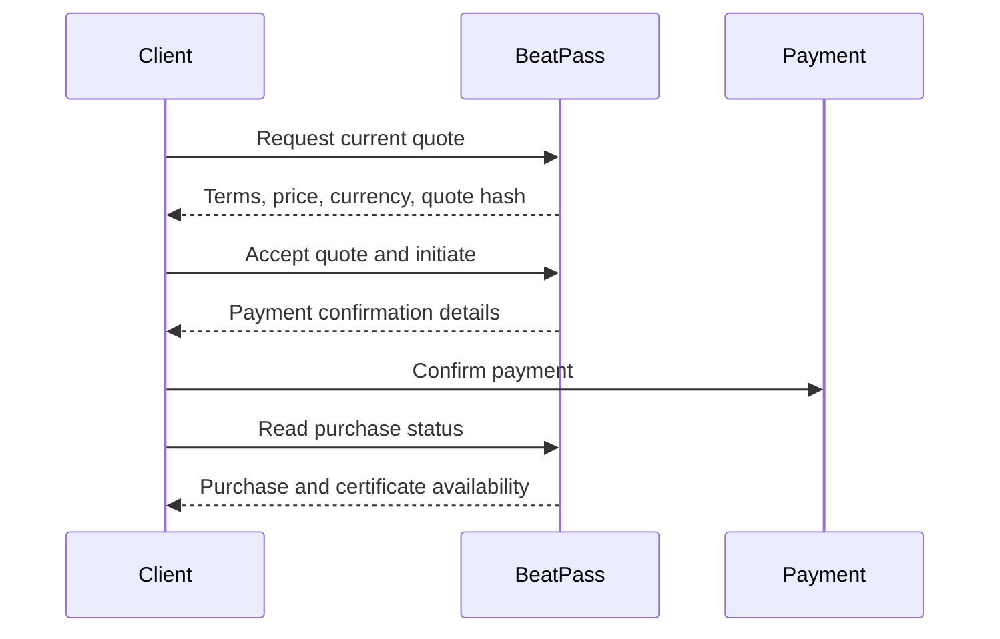

import SyntheticFixtures from "/snippets/developer/synthetic-fixtures.mdx";

These routes describe price quotes, accepted exclusive terms, purchases, and license certificates. It also covers exclusive license preset management and safe producer finance references for approved integrations.

<Info>
  **Base URL:** `https://open.beatpass.ca/api/v1`

  **Authentication:** Most routes require an approved token and endpoint permission. Public UUID verification and checkout coupon validation are exceptions. Write and payment tests require a separately authorized isolated environment; the public host is production.
</Info>

---

## Track Purchases

### Calculate Price

Get pricing details for a track before initiating purchase.

```http
POST /api/v1/tracks/{track}/purchase/calculate-price
```

<ParamField path="track" type="integer" required>
  Track ID to get pricing for.
</ParamField>

**Response:**

Pricing fields are returned at the top level alongside `status: success`, without a `data` wrapper:

- `track_price`: the exclusive track price
- `platform_fee`, `platform_fee_rate`, and `platform_fee_flat`: calculated fee and configured fee inputs
- `platform_fee_waived`, `platform_fee_plan_id`, and `platform_fee_plan_name`: fee-waiver and plan information
- `total_amount`: `track_price + platform_fee`
- `artist_amount`: the track price
- `currency` and `license_terms`
- `license_terms_hash`: acceptance hash covering the current rights, track price, platform fee, total, and currency

`base_price` and `is_exclusive` are not returned fields. Actual fees depend on configuration and can be waived.

---

### Initiate Purchase

Start the purchase flow by creating a Stripe <Tooltip tip="A Stripe object that tracks a payment from creation to completion. The client_secret is used to confirm payment on the frontend.">PaymentIntent</Tooltip>.

```http
POST /api/v1/tracks/{track}/purchase/initiate
```

<ParamField path="track" type="integer" required>
  Track ID to purchase.
</ParamField>

<ParamField body="accept_license_terms" type="boolean" required>
  Must be `true` after the buyer has reviewed and explicitly accepted the displayed terms and quote.
</ParamField>
<ParamField body="license_terms_hash" type="string" required>
  The current 64-character hash returned by Calculate Price. Send the hash for the terms and quote the buyer accepted.
</ParamField>

The buyer and every recorded producer must have confirmed legal identities. Complete the identity steps shown in BeatPass; saving a public display name is not sufficient. The producer must sign the current exclusive offer before checkout is available. Names, rights, the accepted quote, and consent evidence are preserved with the purchase.

If the rights, price, fee, total, or currency change, initiation returns `409` before creating a payment intent. Fetch a fresh quote, display it, and obtain acceptance again. Missing or invalid acceptance fields return `422`.

**Response:**

The response returns `status: success`, `client_secret`, `purchase_id`, and `pricing` at the top level, without a `data` wrapper. `pricing` contains the fields described under Calculate Price, including `track_price`, `platform_fee`, `total_amount`, and `currency`.

<Warning>
  Use the `client_secret` with Stripe.js on the frontend to complete payment confirmation. Do not store or log client secrets.
</Warning>

**Common Errors:**

| Error | Code | Cause |
|-------|------|-------|
| Track purchases not enabled | 403 | Purchases are unavailable |
| Cannot purchase own track | 422 | Buyer owns the track |
| Producer catalog restriction | 422 | Producer accounts cannot start new exclusive catalog purchases |
| Already purchased | 422 | User already owns license |
| Artist not set up for payments | 422 | Artist is not payout-ready |
| Legal name or signed offer missing | 422 | Required party identity or current producer authorization is incomplete |
| Acceptance missing or invalid | 422 | The request does not include explicit acceptance and a valid quote hash |
| Accepted quote changed | 409 | Display a fresh quote and obtain acceptance again |

---

### Check Purchase Status

Check whether the authenticated user has purchased a specific track.

```http
GET /api/v1/tracks/{track}/purchase/status
```

**Response:**

The response returns `status: success`, `has_purchased`, `can_purchase`, `can_start_checkout`, `requires_legal_name`, `reason`, `reason_code`, and `purchase_status` at the top level, without a `data` wrapper. `reason` is a human-readable eligibility message or `null`, not a fixed `already_purchased` code. `reason_code` is supplied for some restrictions and otherwise is `null`; `purchase_status` is the latest purchase status or `null`. `can_start_checkout` checks eligibility before the buyer-name gate; `requires_legal_name` indicates that gate. Treat eligibility as current state, not a reservation of the beat. Producer accounts cannot start new catalog purchases; existing purchase and valid-license records remain separate from new-purchase eligibility.

---

### User Purchases

Get the authenticated user's purchase history.

```http
GET /api/v1/purchases
```

<ParamField query="per_page" type="integer">
  Results per page. Default: `15`.
</ParamField>

---

### Artist Sales

For currency-aware sales reporting, use [Producer Finance Activity](#producer-finance-activity) and [Producer Finances Summary](#producer-finances-summary). Sales, available earnings, and completed payouts are different states; do not present one as another.

---

## Purchase Flow

<Steps>
  <Step title="Calculate Price">
    Call `POST /tracks/{track}/purchase/calculate-price` to get the current terms, pricing, and `license_terms_hash`. Display them for explicit buyer acceptance.
  </Step>
  <Step title="Initiate Purchase">
    Call `POST /tracks/{track}/purchase/initiate` with `accept_license_terms: true` and the accepted `license_terms_hash`. A changed quote requires fresh acceptance before a PaymentIntent can be created.
  </Step>
  <Step title="Confirm Payment">
    Use the returned `client_secret` with Stripe.js `confirmCardPayment()` on the frontend.
  </Step>
  <Step title="Webhook Confirmation">
    BeatPass confirms the payment and updates purchase and certificate availability. Read purchase status before showing completion; the browser payment result alone is not the final license state.
  </Step>
  <Step title="Access License">
    The buyer can download the track and retrieve their license certificate.
  </Step>
</Steps>



---

## License Certificates

### Check License

Check if a license exists for a track.

```http
GET /api/v1/tracks/{track}/check-license
```

### Batch Check Licenses

Check licenses for multiple tracks at once.

```http
POST /api/v1/tracks/check-licenses-batch
```

### View License Certificate

Retrieve a rendered HTML license certificate page for a purchased track.

```http
GET /api/v1/tracks/{track}/license-certificate
```

<ParamField path="track" type="integer" required>
  Track ID to retrieve the license certificate for.
</ParamField>

### Download License PDF

Retrieve JSON data for client-side PDF generation. A successful response has `license`, `track`, `trackChangedToExclusive`, and `message` fields; this endpoint does not return PDF bytes.

```http
GET /api/v1/tracks/{track}/download-license-pdf
```

### Verify License (Public)

Verify a license certificate by its UUID. This endpoint does not require authentication.

```http
POST /api/v1/verify-license/{uuid}
```

<ParamField path="uuid" type="string" required>
  License certificate UUID.
</ParamField>
<ParamField body="g-recaptcha-response" type="string">
  Supply a CAPTCHA response when the verification flow requires one. Keep it out of logs and shared examples.
</ParamField>

### Identity and Certificate Recovery

If a certificate requires legal-name confirmation, direct the account holder to **My licenses** in BeatPass. Use the in-product confirmation flow; changing a public profile name does not complete certificate identity. Keep the original certificate and any separately issued replacement with their own records.


### User Licenses

List license records for the authenticated user, including the history and identity state returned by the endpoint. An original grant, a replacement certificate, and current certificate usability are separate concepts; do not infer revocation from an identity or rendering issue.

```http
GET /api/v1/user/licenses
```

---

## Exclusive License Presets

Manage reusable license-term presets — <Tooltip tip="A saved set of rights and delivery terms that producers can reuse across multiple beats for exclusive sales.">exclusive license presets</Tooltip> — for exclusive license sales.

### List Presets

```http
GET /api/v1/exclusive-license-presets
```

### Get Default Config

Retrieve the default exclusive license configuration.

```http
GET /api/v1/exclusive-license-presets/default-config
```

### Get Preset

```http
GET /api/v1/exclusive-license-presets/{preset}
```

### Create Preset

```http
POST /api/v1/exclusive-license-presets
```

### Update Preset

```http
PUT /api/v1/exclusive-license-presets/{preset}
```

### Delete Preset

```http
DELETE /api/v1/exclusive-license-presets/{preset}
```

### Set Default Preset

```http
POST /api/v1/exclusive-license-presets/{preset}/set-default
```

---

## Artist Exclusive License Default

Manage the artist's default exclusive license configuration, auto-applied to new tracks.

### Get Default

```http
GET /api/v1/artist/exclusive-license-default
```

### Set Default

```http
POST /api/v1/artist/exclusive-license-default
```

---

## Coupon Validation

Validate a discount code during checkout. Use this validation operation for checkout discounts.

### Validate Coupon Code

Check if a coupon code is valid and calculate the discount amount.

```http
POST /api/v1/billing/coupons/validate
```

<ParamField body="code" type="string" required>
  Coupon code to validate.
</ParamField>
<ParamField body="product_id" type="integer">
  Product/plan ID the coupon will be applied to.
</ParamField>
<ParamField body="price_id" type="integer">
  Price ID the coupon will be applied to.
</ParamField>
<ParamField body="amount" type="number">
  Original amount (before discount) for calculating savings.
</ParamField>

**Success response excerpt** (other coupon model fields omitted):

<SyntheticFixtures />

```json
{
  "status": "success",
  "coupon": {
    "id": 900000001,
    "code": "SYNTHETICCOUPON",
    "type": "percentage",
    "value": "20.00"
  },
  "discount_amount": 5.99,
  "final_amount": 23.99,
  "savings": 5.99,
  "valid": true
}
```

**Error Responses:**

| Error | Code | Cause |
|-------|------|-------|
| Invalid or expired coupon code | 422 | Code not found or expired |
| You cannot use this coupon | 422 | User-specific restriction |
| Cannot be applied to selected plan | 422 | Coupon not valid for this product |

---

## Producer Payout Setup

<Info>
  BEATPAY bank payout setup is an in-product Producer Finances workflow, not a public developer integration surface. Do not build integrations against undocumented payout setup routes.
</Info>

For setup, country eligibility, and bank details, direct the producer to **Finances** in BeatPass. The API operations below provide account-authorized reporting.


### Producer Finances Summary

Return local payout setup, currency-specific earnings totals in minor units, attention count, and calculation time for an artist managed by the authenticated user.

```http
GET /api/v1/artists/{artist}/finances/summary
```

The response keeps currencies separate and includes payout setup readiness. Use the returned setup status to guide the producer back to **Finances** when action is needed. A finance read does not complete setup or release a payout.

### Producer Finance Activity

Return a filtered, paginated union of track sales and subscription earnings.

```http
GET /api/v1/artists/{artist}/finances/transactions?status=all&type=all&page=1&per_page=20
```

Supported status values are `all`, `waiting`, `sending`, `needs_attention`, `completed`, and `refunded`. Supported type values are `all`, `sales`, and `subscriptions`. The endpoint still accepts the legacy `filter` parameter for compatibility. The default and maximum page size is `20`.

The response includes `pagination.page`, `perPage`, `total`, `from`, `to`, `hasPrevious`, and `hasMore`. Status and type counts describe eligible earnings, so an unsuccessful checkout that never became an earning is not included.

Amounts use `amountMinor`, `minorUnitFactor`, and an ISO currency code. Use the returned ISO currency and factor for formatting; never add amounts in different currencies into one total.


## Related Resources

<Columns cols={2}>
  <Card title="Webhooks" icon="link" href="/developers/webhooks">
    Payment event processing overview for purchase confirmation.
  </Card>
  <Card title="Error Catalog" icon="triangle-exclamation" href="/developers/error-catalog">
    Purchase and licensing error codes.
  </Card>
</Columns>
