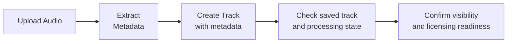

import SyntheticFixtures from "/snippets/developer/synthetic-fixtures.mdx";

Browse content routes for tracks, albums, artists, playlists, lyrics, producer requests, and supporting tools. Each operation has its own authorization and validation rules; a listed route does not grant upload or publication permission.

<Info>
  **Base URL:** `https://open.beatpass.ca/api/v1`

  **Authentication:** Authentication varies by endpoint. Lyrics require sign-in, including read operations. Write operations require authentication.
</Info>

---

## Tracks

### List Tracks

```http
GET /api/v1/tracks
```

<Note>
  Public endpoint. Returns enhanced data (purchase status, like status) when authenticated.
</Note>

### Get Track

```http
GET /api/v1/tracks/{track}
```

### Create Track

Upload a new track. Requires authentication and permission to create tracks. Upload-minute limits and licensing requirements can also restrict creation. A successful create returns HTTP `200`.

```http
POST /api/v1/tracks
```

### Update Track

```http
PUT /api/v1/tracks/{track}
```

### Delete Track(s)

```http
DELETE /api/v1/tracks/{ids}
```

<ParamField path="ids" type="string" required>
  Comma-separated track IDs to delete.
</ParamField>

### Download Track

```http
GET /api/v1/tracks/{track}/download
```

### Get Waveform Data

```http
GET /api/v1/tracks/{track}/wave
```

### Batch Waveform Data

```http
POST /api/v1/tracks/wave-batch
```

### Extract Metadata

Extract metadata from an uploaded audio file entry.

```http
POST /api/v1/tracks/{fileEntry}/extract-metadata
```

### Log Track Play

Record a play event for a track.

```http
POST /api/v1/tracks/{track}/plays
```

### Update Play Duration

Update the listen duration of an active playback.

```http
POST /api/v1/tracks/plays/{track}/update-duration
```

### Get Engagement Metrics

```http
GET /api/v1/tracks/{track}/engagement-metrics
```

### Get Producer Analytics

```http
GET /api/v1/tracks/{track}/producer-analytics
```

Access depends on the endpoint's permissions. Use producer analytics only for resources you are authorized to manage; a valid token alone does not establish ownership.

---

## Track Upload Flow

<Steps>
  <Step title="Upload Audio File">
    Upload the audio file via the file upload system to get a `fileEntry` ID.
  </Step>
  <Step title="Extract Metadata">
    Call `POST /tracks/{fileEntry}/extract-metadata` for the available audio metadata. Review and supply required musical fields; extraction does not guarantee a complete create payload.
  </Step>
  <Step title="Create Track">
    Call `POST /tracks` with `name`, `image`, `duration`, `artists`, `licensing_type`, `key`, `scale`, `bpm`, `url`, and `src`. A file entry ID alone is not a create payload: `url` and `src` must refer to the completed audio upload authorized for your account. Arbitrary remote audio URLs are not accepted for publication. Additional fields are conditionally required for exclusive licensing, sample-safety declarations, and AI disclosure. Exclusive offers require complete terms, WAV and stems deliverables, and your deliverables guarantee. Uploading does not complete payout or licensing readiness.
  </Step>
  <Step title="Audio Fingerprinting">
    Fingerprint processing runs separately from the create response. A successful save is not proof of completed fingerprinting or rights clearance.
  </Step>
  <Step title="Check the saved state">
    Read the returned track and its visibility. Confirm licensing readiness and processing status before treating it as available for streaming, licensing, or sale.
  </Step>
</Steps>



---

## Albums

### List Albums

```http
GET /api/v1/albums
```

### Get Album

```http
GET /api/v1/albums/{album}
```

### Create Album

```http
POST /api/v1/albums
```

### Update Album

```http
PUT /api/v1/albums/{album}
```

### Delete Album(s)

```http
DELETE /api/v1/albums/{ids}
```

### Album Producer Analytics

```http
GET /api/v1/albums/{album}/producer-analytics
```

---

## Artists

### List Artists

```http
GET /api/v1/artists
```

### Get Artist

```http
GET /api/v1/artists/{artist}
```

### Get Artist's Tracks

```http
GET /api/v1/artists/{artist}/tracks
```

### Get Artist's Albums

```http
GET /api/v1/artists/{artist}/albums
```

### Producer Analytics

```http
GET /api/v1/artists/{artist}/producer-analytics
```

### Artist Activity

Returns the period summary and a paginated list of audience download events used by the Producer Activity page. Access is limited to users who manage the artist or have analytics access.

```http
GET /api/v1/artists/{artist}/activity?period=90d&page=1&per_page=1
```

| Parameter | Type | Default | Description |
| --- | --- | --- | --- |
| `period` | string | `90d` | `7d`, `30d`, `90d`, or `all` |
| `page` | integer | `1` | Page number, starting at 1 |
| `per_page` | integer | `20` | Results per page, from 1 to 50 |

<SyntheticFixtures />

```json
{
  "hasTracks": true,
  "period": {
    "key": "90d",
    "start": "2026-05-09T12:00:00Z",
    "end": "2026-08-07T12:00:00Z"
  },
  "summary": {
    "audienceDownloads": 14,
    "uniqueDownloaders": 2,
    "licensesIssued": 5,
    "audiencePlays": 348,
    "likes": 20,
    "reposts": 0,
    "comments": 0,
    "topDownloadedTrack": {
      "id": 900000101,
      "name": "Example Track",
      "image": "https://cdn.example.com/track.webp",
      "downloads": 4
    }
  },
  "downloadEvents": [
    {
      "id": 900000102,
      "occurredAt": "2026-06-01T17:31:39+00:00",
      "track": {
        "id": 900000103,
        "name": "Example Track",
        "image": "https://cdn.example.com/track.webp"
      },
      "downloader": {
        "id": 900000104,
        "displayName": "Listener",
        "avatar": null
      },
      "license": {
        "uuid": "00000000-0000-4000-8000-000000000001",
        "type": "non_exclusive",
        "status": "active"
      }
    }
  ],
  "pagination": {
    "page": 1,
    "perPage": 1,
    "total": 14,
    "hasMore": true
  }
}
```

Audience metrics exclude accounts that manage the artist. Anonymous plays remain included. Summary totals cover the entire matching period, while `downloadEvents` contains only the selected page. `pagination.total` and `summary.audienceDownloads` both count the matching downloads; `hasMore` is true when `page * perPage` is less than that total.

### Downloads Analytics

```http
GET /api/v1/artists/{artist}/downloads-analytics
```

### Producer Achievements

```http
GET /api/v1/artists/{artist}/producer-achievements
```

### Check Ownership

Check if the authenticated user owns this artist profile.

```http
GET /api/v1/artists/{artist}/check-ownership
```

---

## Producer Program Requests (Backstage)

Producer/artist profile requests are managed through the Backstage request flow.

### Get Submission Status

Check whether the authenticated user can submit a new producer request.

```http
GET /api/v1/backstage-request/submission-status
```

**Response (can submit):**

```json
{
  "status": "success",
  "can_submit": true,
  "block_reason": null,
  "message": null,
  "contact_url": null,
  "blocking_request_id": null
}
```

**Response (blocked):**

<SyntheticFixtures />

```json
{
  "status": "success",
  "can_submit": false,
  "block_reason": "revoked",
  "message": "Your producer access was revoked. To appeal, contact support at /contact so admins can review your request for reinstatement.",
  "contact_url": "/contact",
  "blocking_request_id": 900000003
}
```

### Create Backstage Request

Submit a new producer request.

```http
POST /api/v1/backstage-request
```

<ParamField body="type" type="string" required>
  Request type. Supported values: `become-artist`, `verify-artist`, `claim-artist`.
</ParamField>

<ParamField body="artist_name" type="string" required>
  Display name for the producer/artist request.
</ParamField>

<ParamField body="artist_id" type="integer">
  Required for `claim-artist`, where it must identify an existing artist. For other new requests, omitting this field defaults to the authenticated user's primary artist when available. `CURRENT_USER` is not resolved as an artist ID by this endpoint.
</ParamField>

<ParamField body="data" type="object" required>
  Request payload object. Must include `beats_url` as a valid URL. Optional supporting fields include `first_name`, `last_name`, `role`, and `company`.
</ParamField>

<ParamField body="data.beats_url" type="string" required>
  Valid URL linking to the applicant's beats.
</ParamField>

### Submission Guard Policy

Read the returned `can_submit`, `block_reason`, and message before offering a new producer application. A pending application must finish review first. If access has been revoked, follow the contact guidance instead of submitting repeatedly. A conflict response does not consume a new application.


### Conflict Responses (Create)

```json
{
  "message": "Your application is already under review. Please wait for the decision email before submitting another request.",
  "error_code": "backstage_request_pending"
}
```

```json
{
  "message": "Your producer access was revoked. To appeal, contact support at /contact so admins can review your request for reinstatement.",
  "error_code": "backstage_request_revoked"
}
```

---

## Artist Credits

Professional portfolio credits (similar to Spotify credits). Allows artists to showcase their work on external releases.

### List Credits

```http
GET /api/v1/artists/{artist}/credits
```

### Add Credit

```http
POST /api/v1/artists/{artist}/credits
```

### Add Album Credit

```http
POST /api/v1/artists/{artist}/credits/album
```

### Update Credit

```http
PUT /api/v1/artists/{artist}/credits/{credit}
```

### Delete Credit

```http
DELETE /api/v1/artists/{artist}/credits/{credit}
```

### Reorder Credits

```http
POST /api/v1/artists/{artist}/credits/reorder
```

### Spotify Search (for Credits)

Search Spotify catalog to link credits to releases.

```http
GET /api/v1/credits/spotify-search
```

### Get Spotify Album

```http
GET /api/v1/credits/spotify-album
```

### Credit Roles (Public)

Get the list of available credit roles (e.g., Producer, Engineer, Songwriter).

```http
GET /api/v1/credits/roles
```

---

## Track Pinning

Pin a featured track to the top of an artist's profile.

### Pin Track

```http
POST /api/v1/artists/{artistId}/tracks/{trackId}/pin
```

### Unpin Track

```http
POST /api/v1/artists/{artistId}/tracks/{trackId}/unpin
```

### Get Pinned Track

```http
GET /api/v1/artists/{artistId}/pinned-track
```

---

## Playlists

### List Playlists

```http
GET /api/v1/playlists
```

### Get Playlist

```http
GET /api/v1/playlists/{id}
```

### Create Playlist

```http
POST /api/v1/playlists
```

### Update Playlist

```http
PUT /api/v1/playlists/{playlist}
```

`public` and `collaborative` are optional JSON booleans. Omit either field to keep its existing value; `null` is rejected.

### Delete Playlist(s)

```http
DELETE /api/v1/playlists/{ids}
```

### Follow Playlist

```http
POST /api/v1/playlists/{id}/follow
```

### Unfollow Playlist

```http
POST /api/v1/playlists/{id}/unfollow
```

### Get Playlist Tracks

```http
GET /api/v1/playlists/{id}/tracks
```

### Add Tracks

```http
POST /api/v1/playlists/{playlist}/tracks/add
```

### Remove Tracks

```http
POST /api/v1/playlists/{playlist}/tracks/remove
```

### Reorder Tracks

```http
POST /api/v1/playlists/{playlist}/tracks/order
```

---

## Playlist Collaboration

### Invite Collaborator

```http
POST /api/v1/playlists/{playlist}/invite
```

### Accept Invitation

```http
POST /api/v1/playlists/{playlist}/accept-invite
```

### Decline Invitation

```http
POST /api/v1/playlists/{playlist}/decline-invite
```

### Remove Editor

```http
POST /api/v1/playlists/{playlist}/remove-editor
```

<Note>
  The owner or another authorized editor can invite users only when the playlist is collaborative. Existing editors, pending invitations, and invitations to the owner are rejected. No editor cap, invitation expiry, or re-invite cooldown is specified by this endpoint contract.
</Note>

---

## Lyrics

Sign-in is required for every lyrics endpoint. Track lyrics are personal to the signed-in user.

### List Lyrics

```http
GET /api/v1/lyrics
```

### Get Track Lyrics

```http
GET /api/v1/tracks/{id}/lyrics
```

### Create Lyrics

```http
POST /api/v1/lyrics
```

### Update Lyrics

```http
PUT /api/v1/lyrics/{id}
```

### Delete Lyrics

```http
DELETE /api/v1/lyrics/{ids}
```

---

## Audio Fingerprinting

Audio processing can continue after an upload is saved. Processing completion does not establish ownership or clear third-party rights.

### Check Duplicates

Check completed audio uploaded for your account against existing fingerprints. Sign-in is required.

```http
POST /api/v1/tracks/check-duplicates
```

| Field | Type | Requirement |
| --- | --- | --- |
| `playback_url` | string | URL returned for your authorized completed audio upload |
| `track_name` | string | Required; up to 255 characters |
| `artist_names` | string[] | Required; each name up to 255 characters |
| `exclude_track_id` | integer | Optional existing track you are allowed to update |

A match requires review. It is not a legal finding and does not grant permission to publish another person's audio.

---

## Audio Recon

Audio Recon detects songs on streaming platforms (Spotify, YouTube, Deezer) that share audio characteristics with tracks on BeatPass. Results are available to the direct track owner or linked credited producers.

<Note>
  Audio Recon processes eligible audio over time. Use `scan_status` and `scanned_at` to show the available result and its freshness. A response does not promise a scan by a particular date.
</Note>

### Get Audio Recon Matches

Retrieve detected audio similarities for a specific track. Requires authentication. Available to the direct track owner or linked credited producers.

```http
GET /api/v1/tracks/{track}/placements
```

<ParamField path="track" type="integer" required>
  The track ID to retrieve Audio Recon matches for.
</ParamField>

**Response:**

<SyntheticFixtures />

```json
{
  "placements": [
    {
      "id": 900000002,
      "title": "Synthetic title Fixture",
      "artist_name": "Synthetic artist name Fixture",
      "album_name": "Synthetic album name Fixture",
      "release_date": "2025-06-15",
      "confidence_score": 95,
      "spotify_url": "https://example.com/synthetic-fixture",
      "youtube_url": "https://example.com/synthetic-fixture",
      "deezer_url": "https://example.com/synthetic-fixture",
      "created_at": "2026-02-20T12:00:00+00:00"
    }
  ],
  "scan_status": "complete",
  "scanned_at": "2026-02-26T02:15:00+00:00",
  "total_count": 1,
  "artist_verified": true
}
```

<ResponseField name="placements" type="array">
  Array of detected audio similarities, sorted by confidence score (highest first).
</ResponseField>

<ResponseField name="placements[].confidence_score" type="integer">
  Provider confidence score on a 0–100 scale, not a calibrated probability of infringement. A high score still requires listening and checking the context before taking action.
</ResponseField>

<ResponseField name="placements[].spotify_url" type="string | null">
  Direct link to the matched song on Spotify, if available.
</ResponseField>

<ResponseField name="placements[].youtube_url" type="string | null">
  Direct link to the matched song on YouTube, if available.
</ResponseField>

<ResponseField name="placements[].deezer_url" type="string | null">
  Direct link to the matched song on Deezer, if available.
</ResponseField>

<ResponseField name="total_count" type="integer">
  Total number of matches returned.
</ResponseField>

<ResponseField name="scan_status" type="string | null">
  Current scan state for the track (`processing`, `complete`, `no_results`, `failed`, or `null` before first scan).
</ResponseField>

<ResponseField name="scanned_at" type="string | null">
  ISO timestamp of the latest scan attempt.
</ResponseField>

<ResponseField name="artist_verified" type="boolean">
  Whether any artist credited on the track has a verified profile. The endpoint returns no placements when this is false.
</ResponseField>

<Warning>
  Audio Recon detects audio **similarity**, not confirmed placements. A match could indicate your beat was used, a shared sample, or coincidence. Always verify by listening.
</Warning>

| Error | Code | Cause |
|-------|------|-------|
| Unauthenticated | 401 | No valid Bearer token provided |
| Forbidden | 403 | You are not the direct track owner or a linked credited producer |
| Not Found | 404 | Track does not exist |

---

## Cover Art

### List Templates

```http
GET /api/v1/cover-art/templates
```

### Get Template

```http
GET /api/v1/cover-art/templates/{template}
```

### Preview Cover Art

Preview cover art selected for the supplied genres.

```http
POST /api/v1/cover-art/preview
```

<ParamField body="genres" type="array" required>
  Genre names. After normalization, provide one to three distinct, nonblank names of at most 100 characters each.
</ParamField>

### Get Matching Templates

Get templates that match the supplied genres.

```http
GET /api/v1/cover-art/matching-templates
```

<ParamField query="genres" type="array" required>
  Genre names, for example `?genres[]=hip-hop`. After normalization, provide one to three nonblank names of at most 100 characters each.
</ParamField>

---

## Related Resources

<Columns cols={2}>
  <Card title="Commerce & Licensing" icon="cart-shopping" href="/developers/api-reference/commerce">
    Purchase flow and license certificates for tracks.
  </Card>
  <Card title="Search & Discovery" icon="magnifying-glass" href="/developers/api-reference/search">
    Search, genres, tags, and radio recommendations.
  </Card>
</Columns>
