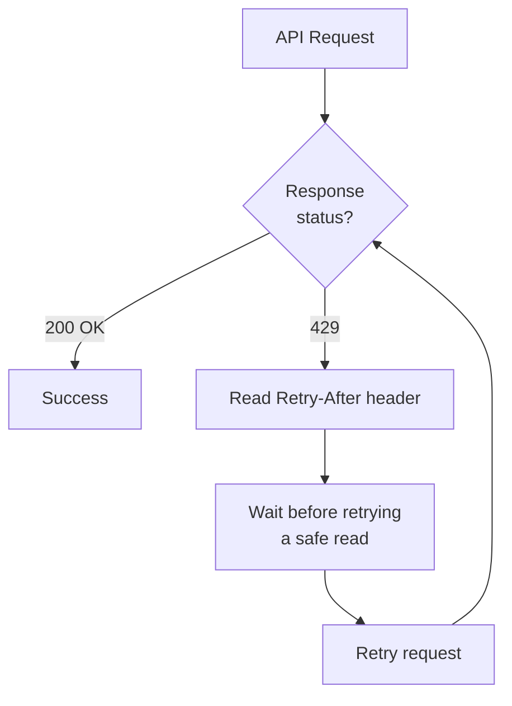

The BeatPass API enforces <Tooltip tip="A cap on how many API requests you can make within a time window to prevent abuse and ensure fair access.">rate limits</Tooltip> to ensure fair usage and platform stability. Different endpoint categories have different limits based on their resource intensity.

---

## Global Rate Limit

The shared API budget is **300 requests per minute**. An endpoint can also have a lower limit. Read the headers returned by your request; separate operations can share a budget.

## Rate Limit Categories

Do not assume every endpoint in a category has the same request allowance. Authentication and sensitive actions also have their own protections. When throttled, wait for the response's retry interval before sending another request.

---

## Rate Limit Format

Rate limits are expressed as requests per time window:

- **Requests:** Maximum number of requests allowed
- **Window:** Time period (typically 1 minute)

A limit of 60 requests per minute permits up to 60 requests in the limiter's current window. Do not assume it uses a sliding window or that each endpoint has an independent budget.

---

## Rate Limit Headers

Inspect the rate-limit headers returned by the endpoint. The following header values are illustrative, not captured production values:

```http
X-RateLimit-Limit: 300
X-RateLimit-Remaining: 298
```

<ResponseField name="X-RateLimit-Limit" type="integer">
  Maximum requests allowed in the current window.
</ResponseField>

<ResponseField name="X-RateLimit-Remaining" type="integer">
  Number of requests remaining in the current window.
</ResponseField>

<ResponseField name="X-RateLimit-Reset" type="unix timestamp">
  Unix timestamp for retry availability, when supplied on a throttled response. Do not assume this header is present on successful responses.
</ResponseField>

---

## When Limits Are Exceeded

### <Tooltip tip="An HTTP status code meaning you've exceeded the allowed request rate. Wait for the Retry-After duration before retrying.">429</Tooltip> Response

Illustrative response headers; the actual wait varies:

```http
HTTP/1.1 429 Too Many Requests
Retry-After: 60
```

```json
{
  "message": "Too Many Attempts."
}
```

The wait is supplied in the `Retry-After` header, not a guaranteed `retry_after` JSON field. Some feature endpoints also use `429` for an exhausted token allowance; read the message before scheduling retries.

### Handling Rate Limits

<Steps>
  <Step title="Stop Requests">
    Immediately pause further requests to the limited endpoint.
  </Step>
  <Step title="Check Retry-After">
    Read the <Tooltip tip="An HTTP response header telling you how many seconds to wait before making another request.">`Retry-After`</Tooltip> header for wait duration.
  </Step>
  <Step title="Implement Backoff">
    Use bounded backoff for safe reads. Do not automatically repeat a write unless that endpoint documents retry reconciliation or idempotency.
  </Step>
  <Step title="Resume Carefully">
    Resume with reduced frequency.
  </Step>
</Steps>



---

## Best Practices

### Optimize Request Patterns

<AccordionGroup>
  <Accordion title="Use Batch Endpoints">
    Where available, use batch endpoints to fetch multiple resources in a single request instead of individual calls.
  </Accordion>
  <Accordion title="Cache Responses">
    Cache API responses locally to reduce redundant calls. Most data does not change frequently.
  </Accordion>
  <Accordion title="Paginate Efficiently">
    Request appropriate page sizes. Don't fetch more data than needed.
  </Accordion>
  <Accordion title="Debounce User Input">
    For search-as-you-type features, debounce input by 300ms+ before triggering API calls.
  </Accordion>
</AccordionGroup>

### <Tooltip tip="A retry strategy that doubles the wait time after each failed attempt, preventing further rate-limit hits.">Exponential Backoff</Tooltip>

```javascript
// For GET requests only. Never pass a purchase or upload mutation here.
async function getWithBackoff(url, headers = {}) {
  const maxAttempts = 5;
  for (let attempt = 0; attempt < maxAttempts; attempt++) {
    const response = await fetch(url, {method: 'GET', headers});
    if (response.status !== 429 || attempt === maxAttempts - 1) {
      return response;
    }
    const raw = response.headers.get('Retry-After');
    const seconds = raw === null ? NaN : Number(raw);
    const waitMs = Number.isFinite(seconds) && seconds >= 0
      ? seconds * 1000
      : Math.max(0, Date.parse(raw) - Date.now()) || 1000 * 2 ** attempt;
    await new Promise(resolve => setTimeout(resolve, waitMs));
  }
}
```

---

## Monitoring Usage

### Track Rate Limit Status

```javascript
async function apiRequest(url, options) {
  const response = await fetch(url, options);
  
  const remaining = response.headers.get('X-RateLimit-Remaining');
  const limit = response.headers.get('X-RateLimit-Limit');
  
  if (remaining && parseInt(remaining) < 10) {
    console.warn(`Rate limit warning: ${remaining}/${limit} remaining`);
  }
  
  return response;
}
```

### Common Patterns That Trigger Limits

<AccordionGroup>
  <Accordion title="Polling too frequently" icon="rotate">
    **Problem:** High frequency polling drains your quota.

    **Solution:** Use reasonable intervals (30+ seconds) and cache responses locally.
  </Accordion>
  <Accordion title="Individual resource calls in loops" icon="chart-simple">
    **Problem:** Fetching resources one at a time in a loop.

    **Solution:** Use batch endpoints where available, or paginated listing endpoints.
  </Accordion>
  <Accordion title="Multiple concurrent requests" icon="arrows-split-up-and-left">
    **Problem:** Firing many requests simultaneously.

    **Solution:** Stagger requests and use combined endpoints where available.
  </Accordion>
</AccordionGroup>

---

## Error Recovery

When you hit a rate limit:

1. Pause requests that share the affected budget.
2. Read the message and `Retry-After` header. An exhausted feature allowance needs a different recovery step from HTTP throttling.
3. Retry safe reads after the wait; reconcile a write's state before repeating it.
4. Contact support if the approved integration needs a different request budget.

---

## Next Steps

<Columns cols={2}>
  <Card title="API Reference" icon="code" href="/developers/api-reference/overview">
    See all available endpoints.
  </Card>
  <Card title="Authentication" icon="key" href="/developers/auth">
    Understand API authentication.
  </Card>
</Columns>